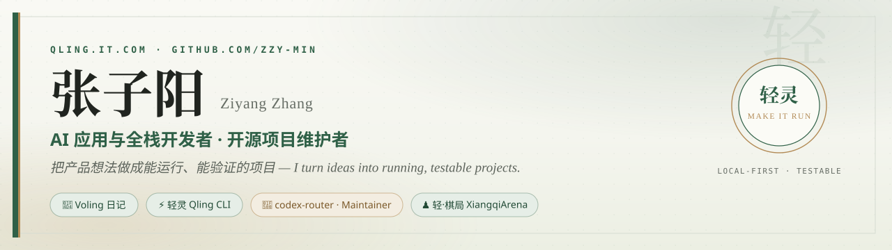
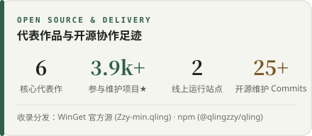
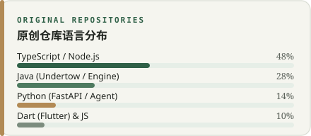

<div align="center">

<!-- 自适应双模 Banner (支持 Light/Dark 模式自适应) -->
<picture>
  <source media="(prefers-color-scheme: dark)" srcset="./assets/banner-dark.svg">
  
</picture>

<p align="center">
  <a href="https://qling.it.com/"></a>
  <a href="https://qling.it.com/resume"></a>
  <a href="https://blog.csdn.net/Zzydzyg0618"></a>
  <a href="mailto:zzy19812007@gmail.com"></a>
  
</p>

</div>

### 🧭 关于我 / About Me

> **“状态在本地，证据可追溯，运行有终态。”**  
> 软件工程在读，专注于 AI Agent 工具链、本地优先架构与高可用全栈工程。坚持“能运行、可验证、有测试门禁”，在真实复杂工程与开源协作中实现端到端闭环交付。

- 📍 **坐标**：中国 · 河南郑州 (Zhengzhou, Henan)
- 🎯 **主攻方向**：AI Agent 工具链 / 本地优先架构 / 全栈工程
- 💼 **状态**：**寻找 AI Agent 研发实习与技术实践机会 (Available for hire)**
- 🏆 **认证**：GitHub Pro · RevenueCat Shipaton Next Gen Award 参赛作品

---

### 🚀 精选代表作 / Featured Projects

#### 🌟 核心产品与工具 (Core Products)

- **[Voling 日记 (Voonie)](https://github.com/Zzy-min/voonie)** `微信小程序` · `TypeScript` · `Python/FastAPI`  
  AI 语音情绪日记与插画回忆产品。面向移动端日常记录场景，将碎片化的语音与文本流智能解析为长青记忆与插画档案，具备软著级工程与数据模型设计。  
  `[核心作品]` · `[小程序+Web多端]` · `[1★]`

- **[Qling (轻灵 CLI)](https://github.com/Zzy-min/qling)** `TypeScript` · `MCP` · `Streaming TUI` · `npm 1.3.1`  
  面向中文开发者的本地优先 AI Agent 命令行工作台。支持流式终端 TUI、Model Context Protocol (MCP) 白名单协议、多轮持久化任务与会话恢复。  
  `[NPM 已发布: @qlingzzy/qling]` · `[4★]` · `[持续维护]`

---

#### 🤝 重点参与开源维护 (Open Source Contributions)

- **[codex-router](https://github.com/duolahypercho/codex-router)** `Core Contributor` · `Node.js` · `PowerShell` · `Shell` · `OAuth`  
  面向 Codex 及现代 AI 编程辅助工具的外部模型路由与管理网关。核心参与其功能维护，涵盖 DeepSeek / Kimi OAuth 授权流引导、跨平台系统托盘控制中心（Control Center）、服务平滑迁移与安全回滚机制。  
  `[主要维护贡献]` · `[多模型路由]` · `[生产级生态集成]`

---

#### ♟️ 全栈 Web & 高可用对弈平台 (Production System)

- **[轻·棋局 XiangqiArena](https://github.com/Zzy-min/Chinese-chess)** `Java 11` · `Undertow (Native)` · `PostgreSQL` · `Cloudflare Tunnel`  
  将中国象棋、五子棋、围棋收束一体的线上实时对弈平台。采用超轻量原生 Undertow 嵌入式引擎替代传统笨重框架，集成 Pikafish/Rapfi 开源引擎，正式上线稳定运行中。  
  🌐 **线上正式站点**：[www.xiangqiarena.com](https://www.xiangqiarena.com/)  
  `[2★]` · `[线上部署]` · `[高可用低延迟架构]`

---

#### 🔬 黑客松与跨端探索 (Hackathon & Multi-Platform)

- **[Qling 出海智察 (Cross-border Insight)](https://github.com/Zzy-min/qling-crossborder-insight)** `React 19` · `Electron` · `Playwright E2E`  
  面向中小跨境卖家的证据约束型 AI 市场决策工作台（CSDN AI+跨境黑客松作品）。具备完整的证据溯源推理链、200 例黄金评测集及跨端 E2E 自动化门禁。  
  `[黑客松作品]` · `[200例黄金评测]`

- **[StudyLoop](https://github.com/Zzy-min/studyloop)** `Flutter` · `Dart` · `SQLite` · `RevenueCat`  
  专为克服学习启动阻力设计的静心离线优先 Android 学习伴侣。RevenueCat Shipaton Next Gen Award 参赛作品。  
  `[Award Entry]` · `[演示视频: YouTube ↗](https://www.youtube.com/watch?v=wFz6Qis-V9M)`

---

### 🧰 技术栈全景 / Tech Stack Matrix

```yaml
AI & Agent:      Model Context Protocol (MCP), DeepSeek / MiniMax / Kimi API, SSE Streaming, Prompt Engineering
Languages:       TypeScript, Java (11/17), Python (3.12), Dart, JavaScript, C
Backend & Ops:   Undertow (Native Java), FastAPI, Node.js, PostgreSQL, HikariCP, Cloudflare Tunnel/Workers, Docker
Frontend & Apps: React 19, Next.js, Flutter (Android/Desktop), WeChat Mini-Program, Electron, TailwindCSS
Engineering:     Playwright (E2E), Vitest, JUnit 5, Golden Dataset Testing, GitHub Actions
```

---

### 📊 工程积累与动态 / Activity & Stats

<div align="center">
  <picture>
    <source media="(prefers-color-scheme: dark)" srcset="./assets/stats-dark.svg">
    
  </picture>
  <picture>
    <source media="(prefers-color-scheme: dark)" srcset="./assets/langs-dark.svg">
    
  </picture>
</div>

<div align="center">
  <picture>
    <source media="(prefers-color-scheme: dark)" srcset="https://raw.githubusercontent.com/Zzy-min/Zzy-min/output/github-snake-dark.svg">
    
  </picture>
</div>

---

### 📬 联系与交流 / Connect

- 🌐 **个人站点**：[qling.it.com](https://qling.it.com/)
- 📄 **在线简历**：[qling.it.com/resume](https://qling.it.com/resume)
- 📧 **电子邮箱**：`zzy19812007@gmail.com` ｜ `2293822701@qq.com`
- 📝 **技术博客**：[CSDN @Zzydzyg0618](https://blog.csdn.net/Zzydzyg0618)
- 💬 **当前诉求**：**寻找 AI Agent 架构研发、全栈开发相关的实习或开源协作机会，欢迎邮件交流！**
